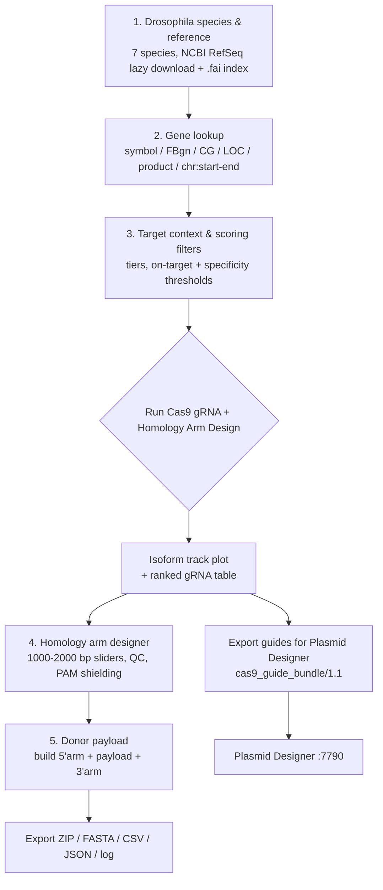
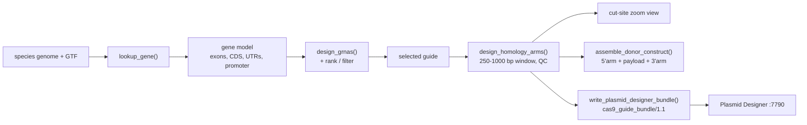

# CRISPR Designer — Application Map

**Purpose:** one-page orientation for anyone (human or agent) working on this app.
Read this before touching code.

- **Entry point:** `Cas9_sgRNA_design.R` (standalone Shiny GUI + headless CLI)
- **Port:** `7789` (`CAS9_PORT` env var overrides) — Plasmid Designer uses 7790
- **Launcher:** `launch_app.sh` → `CRISPR Designer.app` → `/Users/work/bin/crispr-designer.sh`
- **Alt entry:** `app.R` (for `shiny::runApp(".")` / RStudio)

---

## 1. User workflow



---

## 2. Module map (what each file owns)

| Module | Owns | Key exports |
|---|---|---|
| `R/genome_registry.R` | 7-species Drosophila registry, FASTA indexing, random access | `get_species_registry()`, `resolve_chromosome()`, `ensure_fai_index()`, `extract_genomic_subseq()` |
| `R/gene_lookup.R` | Multi-modal gene lookup + isoform feature extraction | `lookup_gene()`, shared-CDS / UTR / promoter extraction |
| `R/grna_engine.R` | SpCas9 discovery, tiering, on-target + off-target scoring | `design_grnas()`, `rank_grna_candidates()`, `filter_grna_candidates()` |
| `R/homology_arms.R` | Cut-site geometry, arm extraction, QC, PAM shielding, exports | `design_homology_arms()`, `build_cut_site_zoom()`, `export_homology_arms_fasta()`, `export_design_csv()` |
| `R/donor_payload.R` | Donor payload read/QC + arm+payload+arm construct | `read_donor_payload()`, `donor_payload_qc()`, `assemble_donor_construct()` |
| `R/pjat_plasmids.R` | pJAT catalog + Gateway attL fragment design (mirror of PD module) | `pjat_load_catalog()`, `pjat_assemble_fragments()`, `pjat_synthesis_qc()` |
| `R/plasmid_designer_bundle.R` | **Producer** of the `cas9_guide_bundle` interop CSV + JSON sidecar | `build_plasmid_designer_bundle()`, `write_plasmid_designer_bundle()` |

---

## 3. Sidebar sections → server reactives → main-panel cards

| # | Sidebar section (UI) | Server reactives / observers | Main-panel card |
|---|---|---|---|
| 1 | **Drosophila Species & Reference** — `selectInput("species")` + download button | `output$species_status_box`, `observeEvent(input$dl_prepare_species_btn)`, `ref_state_bump()` | `gene_banner_ui` (species context) |
| 2 | **Gene Lookup** — `textInput("gene_query")` + presets + disambiguation | `disambig_hits()`, `output$gene_disambig_ui`, `observeEvent(input$search_disambig_btn)` | `gene_banner_ui` |
| 3 | **Target Context & Scoring Filters** — `target_mode`, `allowed_tiers`, score thresholds | `live_filtered_df()` (re-ranks + filters on every change) | `grna_table_card_ui` (DT table) |
| 4 | **Homology Arm Designer** — `arm_5p_len`/`arm_3p_len` sliders, `arm_3p_anchor` | `live_arm_and_zoom()` → `safe_design_homology_arms()`, `compute_cut_site_zoom_view()` | `track_plot_card_ui`, `cut_site_zoom_card_ui` |
| 5 | **Donor Payload** — `donor_payload_seq` / `donor_payload_file` + orientation | `observeEvent(input$run_donor_btn)`, `donor_status()`, `pjd_donor_construct()` | `donor_card_ui` |

**Export bar:** `output$download_bar_ui` → `dl_zip`, `dl_fasta`, `dl_csv`, `dl_json`, `dl_log`, and **`dl_pd_bundle`** ("Export guides for Plasmid Designer").

---

## 4. Data flow (design → export)



---

## 5. Interop contract (producer side)

`write_plasmid_designer_bundle()` emits:

```
Cas9_<gene>_<species>_guides_for_plasmid_designer.csv   (+ .json sidecar)
```

- **Schema:** `cas9_guide_bundle/1.1` (1.0 remains readable by the consumer)
- **Arm window:** 250–1000 bp (rule R2). Arms longer than 1000 bp are trimmed
  from their **outer** end so the bases abutting the Cas9 cut site are preserved.
- **Only the guide with designed arms is exported** — never NA-padded.
- **`spacer_seq`** is exactly 20 nt with the NGG PAM excluded (rule R3).

---

## 6. Design invariants (do not break)

1. **No fabricated sequence** — every nucleotide is copied from the genome or
   supplied by the user.
2. **Cut-site geometry:** SpCas9 cuts 3 bp 5' of the PAM on the target strand.
3. **Arms in genomic orientation** (rule R4) — never flipped.
4. **Spacer = 20 nt, PAM excluded** (rule R3).
5. **250–1000 bp arm window** (rule R2).

---

## 7. Tests

```bash
cd /Volumes/Backup_Plus/projects/bioinformatics/projects/Cas9_sgRNA_design
Rscript -e 'suppressWarnings(library(testthat)); test_dir("tests/testthat")'
```

Test files: donor_payload, gene_lookup, genome_registry, grna_engine,
homology_arms, pjat_plasmids, plasmid_designer_bundle, shiny_app.

> Note: `genome_registry` / `gene_lookup` / `grna_engine` tests read the
> Drosophila reference genomes from `/Volumes/Backup_Plus/.../reference_files/`
> and can take >30 s — run them with a generous timeout.
