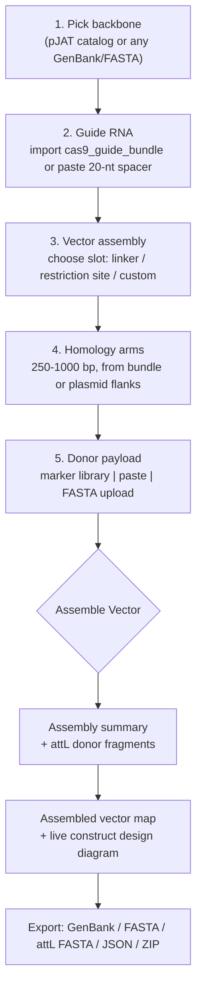
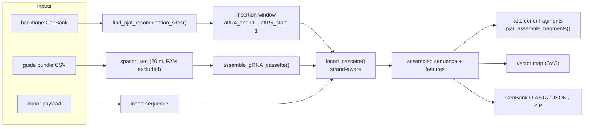
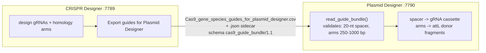

# Plasmid Designer — Application Map

**Purpose:** one-page orientation for anyone (human or agent) working on this app.
Read this before touching code: it shows what lives where, what talks to what, and
which section owns which behaviour.

- **Entry point:** `Plasmid_Designer.R` (standalone Shiny GUI + headless CLI)
- **Port:** `7790` (`PJD_PORT` env var overrides) — CRISPR Designer uses 7789
- **Launcher:** `launch_app.sh` → `Plasmid Designer.app` (macOS one-click)
- **Alt entry:** `app.R` (for `shiny::runApp(".")` / RStudio)

---

## 1. User workflow



---

## 2. Module map (what each file owns)

| Module | Owns | Key exports |
|---|---|---|
| `R/backbone_registry.R` | **Pluggable backbone abstraction (any plasmid)**; slot discovery | `backbone_entry()`, `backbone_registry()`, `backbone_discover_slots()`, `backbone_register_gbk()`, `backbone_register_fasta()`, `backbone_pjat_adapter()`, `backbone_slots()` |
| `R/pjat_plasmids.R` | GenBank parser, pJAT catalog, Gateway fragment assembly | `read_pjat_genbank()`, `find_pjat_recombination_sites()`, `pjat_load_catalog()`, `pjat_assemble_fragments()`, `pjat_validate_spacer()`, `pjat_synthesis_qc()` |
| `R/plasmid_assembly.R` | Insertion math (strand-aware), assembly, cloning sites, GenBank writer | `insert_cassette()`, `assemble_gRNA_cassette()`, `assemble_expression_vector()`, `find_cloning_sites()`, `write_plasmid_genbank()`, `plasmid_qc()` |
| `R/gateway_attl.R` | Published attL3-6 + tRNA templates (Gateway donor fragments) | `pjat_load_attl_templates()`, `pjat_attl_template_sequences()`, `pjat_extract_backbone_attr_sequences()` |
| `R/guide_bundle.R` | `cas9_guide_bundle` reader/validator (1.0 legacy + 1.1) | `read_guide_bundle()`, `guide_bundle_check_compatible()` |
| `R/marker_sequences.R` | Offline marker sequence catalog + loaders | `pjd_get_marker_sequence()`, `pjd_marker_sequence_available()` |
| `R/plasmid_map.R` | Dependency-free inline-SVG vector map (circular + linear) | `pjd_map_record_from_genbank()`, `pjd_map_record_from_assembly()`, `.pjd_interactive_map_ui()` |
| `R/addgene_maps.R` | Addgene/SnapGene PNG manifest + join + PNG QC | `addgene_maps_read()`, `addgene_maps_join()`, `addgene_map_src()`, `png_dimensions()` |
| `R/sample_inputs.R` | Bundled offline sample guide bundle + donor FASTA | `pjd_load_sample_guide_bundle()`, `pjd_load_sample_donor_fasta()` |
| `R/plasmid_assembly_slots.R` | **Multi-slot cloning engine** (any slot, wraparound-safe) | `resolve_slot_window()`, `clone_into_slot()`, `clone_at_restriction_site()` |
| `R/arm_resolution.R` | **Homology-arm resolution** (bundle-first, 250–1000 bp) | `resolve_homology_arms()`, `arm_trim_to_window()` |
| `R/design_schematic.R` | **Live construct-design SVG** + gRNA-site label | `pjd_design_schematic()`, `pjd_grna_site_label()` |
| `R/onboarding.R` | Getting-started help + worked examples + glossary | `pjd_onboarding_card()`, `pjd_help_*_example()`, `pjd_help_glossary()` |

---

## 3. Sidebar sections → server reactives → main-panel cards

| # | Sidebar section (UI) | Server reactives / observers | Main-panel card |
|---|---|---|---|
| 1 | **pJAT Backbone** — `selectInput("pjat_backbone")` (+ purpose/description) | `pjd_backbone()`, `pjd_backbone_gb()`, `output$backbone_panel_ui`, `output$pjat_picker_purpose`, `output$plasmidplot_map` | `backbone_panel_ui` (identity badges, purpose, **description**, attR coords, vector map) |
| 2 | **Guide RNA** — `radioButtons("guide_source")` bundle vs paste | `observeEvent(input$guide_bundle_csv)`, `observeEvent(input$load_sample_guide)`, `observeEvent(input$spacer_validate_btn)`, `pjd_guide()`, `pjd_selected_spacer()` | `guide_info_ui`, **`design_schematic_ui`** |
| 3 | **Vector Assembly** — `radioButtons("insert_strategy")` + `insert_orient` | `observeEvent(input$run_assembly_btn)`, `output$insert_enzyme_sites`, `pjd_assembly()` | `assembly_card_ui`, `assembly_map_ui` |
| 4 | **Homology Arms** — `radioButtons("arm_source")` + `sliderInput("donor_arm_len")` (250–1000) | `resolve_homology_arms()` inside `run_assembly_btn` | `assembly_card_ui` (fragment status) |
| 5 | **Donor Payload** — `radioButtons("donor_source")`: marker \| paste \| upload | `pjd_donor_payload()` (single source of truth), `output$donor_marker_info`, `observeEvent(input$load_sample_donor)` | `donor_card_ui` (QC + provenance), `sequence_viewer_ui` |

**Export bar:** `output$download_bar_ui` → `dl_plasmid_gb`, `dl_plasmid_fasta`, `dl_attl_fasta`, `dl_assembly_json`, `dl_assembly_zip`.

---

## 4. Data flow (assembly)



---

## 5. Interop with CRISPR Designer



**Contract:** `cas9_guide_bundle/1.0` (legacy, accepted) and `1.1` (current).
Carries `spacer_seq` (20 nt, PAM excluded) plus `arm_5p_seq`/`arm_3p_seq`
(250–1000 bp). Rule R2: 250 bp floor, 1000 bp ceiling.

---

## 6. Design invariants (do not break)

1. **No fabricated sequence.** Every nucleotide is copied verbatim from the
   backbone/genome or supplied by the user.
2. **Arms must be genomic and in genomic orientation** (rule R4) — never flipped.
3. **Spacer must be exactly 20 nt with the NGG PAM excluded** (rule R3).
4. **250–1000 bp arm window** (rule R2).
5. **Never hand-edit generated YAML** — regenerate via `tools/`.

---

## 7. Tests

```bash
cd /Volumes/Backup_Plus/projects/bioinformatics/projects/Plasmid_Designer
Rscript -e 'suppressWarnings(library(testthat)); test_dir("tests/testthat")'
```

Current suite: 11 test files (addgene_maps, backbone_registry, gateway_attl,
guide_bundle, guide_bundle_arm_window, marker_sequences, pjat_plasmids,
plasmid_assembly, plasmid_map, plasmidplot_png, sample_inputs).

